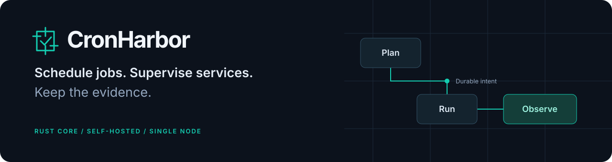
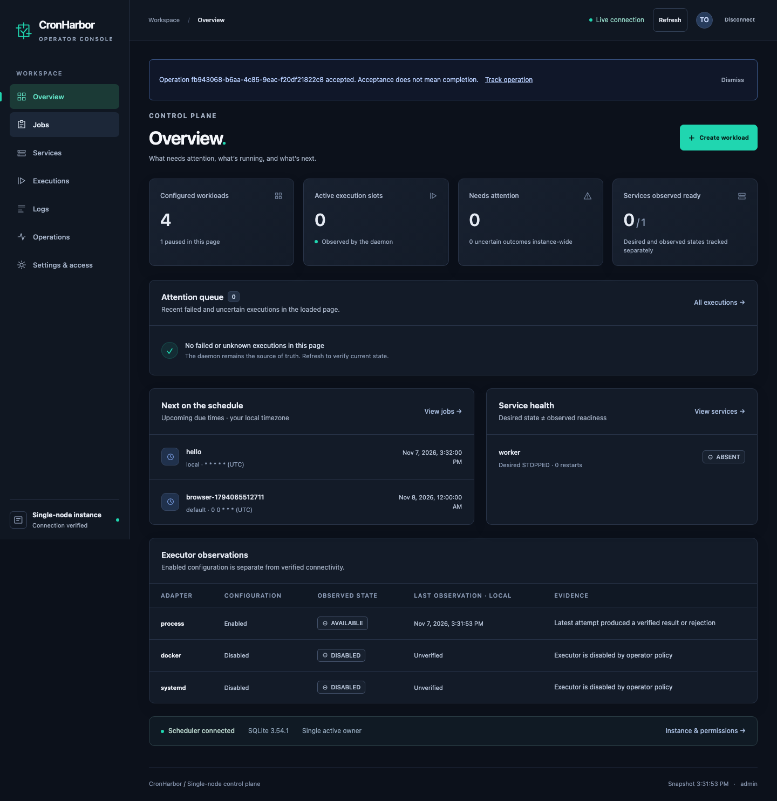
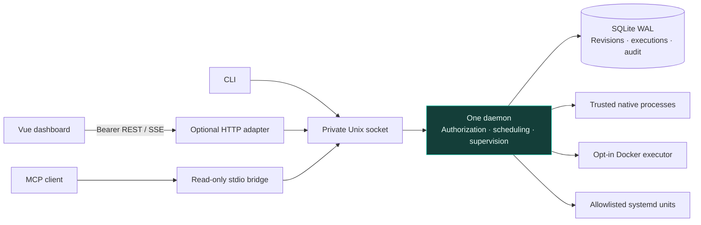
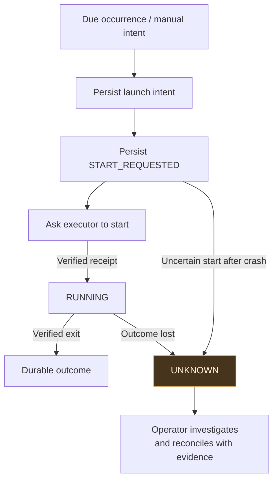

<p align="center">
  
</p>

# CronHarbor

**A self-hosted Rust scheduler and service supervisor, with an optional Vue operator console.**

Run scheduled jobs, trigger one-off tasks, and supervise long-running services from one daemon. Inspect execution history, readiness probes, bounded logs, and durable operation results through the CLI, REST API, dashboard, or read-only MCP tools.

CronHarbor records what it can verify. If a crash leaves an external effect uncertain, the execution stays `UNKNOWN` until an operator reconciles it with evidence. A lost receipt never becomes permission to run the job again.

[Quick start](#quick-start) · [Operator runbook](docs/RUNBOOK.md) · [API and MCP](docs/api/README.md) · [Verification](docs/VERIFICATION.md) · [Contributor rules](AGENTS.md)

## What it does

| Area | Capabilities |
|---|---|
| Scheduling | Five-field numeric cron, IANA time zones, DST policies, anchored intervals, bounded misfires, concurrency limits, and explicit retry policies |
| Services | Desired and observed state, readiness/liveness probes, startup grace, restart backoff and budgets, manual start/stop/restart |
| Execution | Native processes, opt-in Docker with digest-pinned images, and an allowlisted bridge to existing systemd units |
| Control | Owner-only CLI, authenticated REST/SSE, Vue dashboard, and ten read-only MCP observation tools |
| Evidence | Immutable definition revisions, compare-and-swap updates, idempotent operations, audit history, bounded/redacted native log rotation, and explicit reconciliation |
| Operations | Verified SQLite backups, paused restore quarantine, explicit cutoff/resume, and passive Cronicle import reports |
| Alerts | Optional HTTPS incident metadata to one LAN/public API, a bounded durable outbox and explicit operator retries |

The scope is one scheduling owner per installation. Distributed workers, workflow DAGs, and write-capable MCP are outside the current scope.

## Operator console



*Actual application screenshot using disposable test workloads. The console includes jobs, services, definition editing, executions, logs, operations, tokens, and audit history.*

## Quick start

### Docker: dashboard and API

Build and start the complete application from this checkout:

```sh
docker compose -f compose.full.yaml up --build -d
```

Create an administrative credential through the private local control socket:

```sh
docker compose -f compose.full.yaml exec cronharbor \
  cronharbor --state-dir /var/lib/cronharbor tokens create \
  --role admin --namespace '*' --capability '*'
```

Open **http://127.0.0.1:8090** and enter the returned token. The browser keeps it in tab memory. Use narrower grants for routine access; the bootstrap token has full administrative authority.

```sh
docker compose -f compose.full.yaml down
```

State is retained in the named Docker volume. The example binds HTTP to host loopback and mounts no Docker daemon socket. See the [runbook](docs/RUNBOOK.md) before enabling external executors or remote access.

### Build from source

On a Unix host, use the pinned Rust toolchain in [rust-toolchain.toml](rust-toolchain.toml) and Node.js 22 for the dashboard. Run from the repository root; the example configuration's paths resolve from the process working directory:

```sh
npm ci --prefix web/dashboard
npm run build --prefix web/dashboard
cargo build --locked --features full
./target/debug/cronharbor server --config examples/optional/daemon.yaml
```

In another terminal:

```sh
./target/debug/cronharbor tokens create \
  --role admin --namespace '*' --capability '*' \
  --output-file /tmp/cronharbor-admin.token
```

Enter the private file's token in the dashboard. Remove that credential file when no longer needed. By default, the daemon creates private state under `.cronharbor/`; use the same `--state-dir PATH` for daemon and clients to choose another installation.

### Choose a profile

| Profile | Build | Includes |
|---|---|---|
| Core | `cargo build --locked` | Scheduler, supervisor, CLI, local Unix socket; no TCP listener or MCP |
| Core + webhooks | `cargo build --locked --features webhooks` | Core with optional outbound HTTPS alerts; no TCP listener or MCP |
| API | `cargo build --locked --features api` | Core plus authenticated REST/SSE and optional static UI hosting |
| Full | `cargo build --locked --features full` | API plus read-only MCP; build Vue assets separately for source installs |

API and Full include webhook support, activated only by daemon configuration. The Dockerfile has matching `core`, `api`, and `full` targets. Default `docker compose up --build -d` starts the headless Core profile. The Full image includes the built dashboard; no production Node.js server is needed.

## How it fits together



The daemon owns the database and all execution decisions. Transport adapters call its command service; neither the dashboard nor MCP can bypass backend authorization or launch work independently.

### Recovery without blind replay



Durable occurrence deduplication does not guarantee exactly-once external effects. Unknown attempts retain capacity and never retry automatically. A restored snapshot starts paused and requires reconciliation of the backup-to-cutoff interval before explicit resume.

## A few useful commands

```sh
./target/debug/cronharbor status
./target/debug/cronharbor config validate -f examples
./target/debug/cronharbor config plan -f examples
./target/debug/cronharbor jobs list
./target/debug/cronharbor executions
./target/debug/cronharbor log-storage status
./target/debug/cronharbor alerts status
./target/debug/cronharbor services list
```

Runnable workload definitions are in [examples/](examples/). The [runbook](docs/RUNBOOK.md) covers apply, manual runs, service controls, logs, backups, restore, token grants, executor policies, MCP, and migration reports.

## Development and checks

Run verification locally before committing or pushing. GitHub Actions runs only the fast migration/document-link repository checks, with a three-minute job timeout. Full tests, builds, browser acceptance and container checks are local responsibilities.

```sh
python3 scripts/check_repository.py
cargo fmt --all --check
cargo test --locked --all-features --all-targets
cargo clippy --locked --all-features --all-targets -- -D warnings
npm run typecheck --prefix web/dashboard
npm test --prefix web/dashboard
npm run build --prefix web/dashboard
```

Public TypeScript DTOs and the workload JSON Schema are generated from Rust:

```sh
cargo run --locked --features full -- export-types
cargo run --locked --features full -- export-schema
```

Follow [AGENTS.md](AGENTS.md) for type safety, trust boundaries, migration rules, and change verification. See [IMPLEMENTATION.md](IMPLEMENTATION.md) for the source map, [docs/ACCEPTANCE.md](docs/ACCEPTANCE.md) for acceptance scenarios, and [docs/VERIFICATION.md](docs/VERIFICATION.md) for dated test evidence and remaining release gates.

## Deployment boundaries

Native jobs run as the daemon user and must be trusted. Process groups provide lifecycle cleanup, not an adversarial sandbox. Docker execution requires explicit policy and privileged daemon access; systemd units retain their existing OS protections. Remote HTTP deployments require a TLS reverse proxy and restricted backend access.

The software is at version 0.1.0. Production migration, live systemd hardening, performance targets, and multi-architecture release certification still need deployment-specific evidence. Local test results are documented rather than presented as production guarantees.

## License

[Apache License 2.0](LICENSE).
